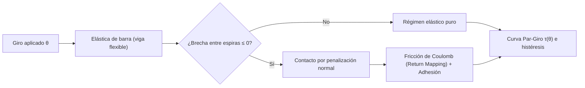

# Resorte de torsión en espiral (v1.4)

---

## ⚙️ Descripción General

Simulador mecánico no lineal de un **resorte espiral de torsión** que calcula la curva de **par mecánico frente al ángulo de giro ($\tau$ vs. $\theta$)**, incorporando grandes deformaciones de la viga, **contacto progresivo entre espiras** y **fricción con adhesión**.

> [!IMPORTANT]
> **Estado del proyecto:** Hipótesis de ingeniería / modelo mecánico de juguete. No es un resultado experimental ni un dispositivo validado en laboratorio.

👉 **[Probar el Simulador Interactivo en Vivo](https://mathigza1211.github.io/resorte-torsion-espiral/)** *(ajusta geometría, fricción y giro en tiempo real desde el navegador).*

---

## 🛠️ Física y Mecánica Computacional

### Módulos Físicos Implementados

| Fenómeno | Formulación en el Simulador |
| :--- | :--- |
| **Deformación de la Espira** | Teoría de la **elástica de barra** (viga flexible sometida a flexión y torsión). |
| **Contacto entre Espiras** | Método de **penalización** cuando el cierre radial supera el espaciamiento entre vueltas. |
| **Fricción Tangencial** | Ley de **Coulomb con algoritmo de retorno de mapeo (*return mapping*)** y modo de deslizamiento plano. |
| **Adhesión Superficial** | Modelo de adhesión por umbral de enlace al entrar en contacto íntimo. |

---

## ⚠️ Límites y Observaciones Críticas

> [!WARNING]
> - **Alcance del modelo de fricción:** El modelo tribológico es de juguete; el par varía $\le 4\%$ hasta $\mu = 0.5$ para un giro de $-6\text{ rad}$, presentando convergencia **parcial** tras iniciarse el contacto múltiple.
> - **Escala MEMS/NEMS:** No se incluyen mediciones experimentales de fricción ni adhesión; a micro/nanoescala dominan fuerzas superficiales (van der Waals, capilaridad, carga electrostática) que requieren caracterización específica.
> - **Mejoras numéricas pendientes:** Incorporar un algoritmo de conjunto activo (*active-set*) con convergencia estricta y un tope exterior rígido de tamaño finito. Se recomienda contrastar con un especialista en MEMS/NEMS.

---

## 📄 Archivos del Repositorio

| Archivo | Descripción |
| :--- | :--- |
| [`index.html`](index.html) | Simulador interactivo con visualización de la espira deformada y gráficas de par/energía. |
| [`informe-resorte-espiral.docx`](informe-resorte-espiral.docx) | Documento técnico con las ecuaciones constitutivas, formulación de contacto y pruebas de sensibilidad. |

---

## 👤 Autoría

**Mathias Zárate Amenero** — *Lima, Perú*  
Desarrollado junto con **Claude (Anthropic)** *(código e informes elaborados con asistencia de IA; los supuestos mecánicos y límites numéricos están declarados arriba).*

🔗 **Ver más proyectos:** [Portafolio de Simuladores y Prototipos](https://github.com/mathigza1211/simuladores-portafolio)
